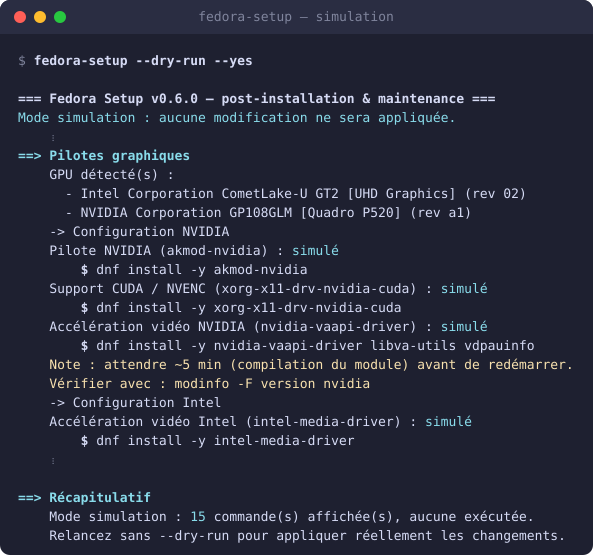
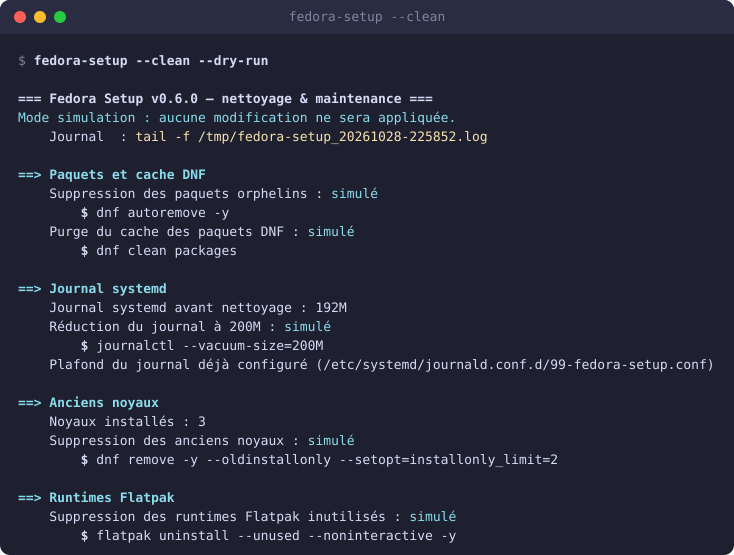
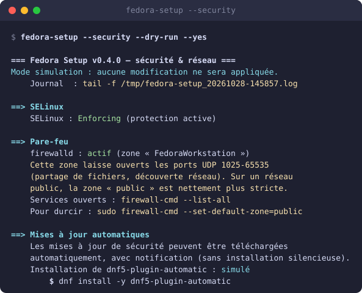
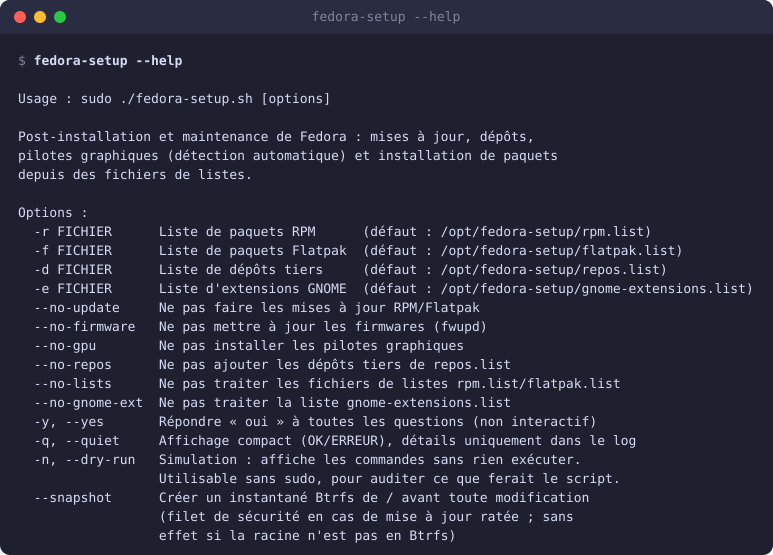
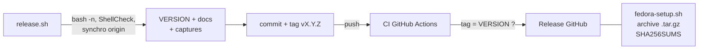

<div align="center">

# 🎩 Fedora Setup

**Post-installation et maintenance de Fedora Workstation, en une commande.**<br>
Dépôts, pilotes graphiques détectés automatiquement, paquets, nettoyage,
autonomie et sécurité — sans refaire les mêmes gestes à chaque installation.

[](https://github.com/William-De71/Fedora-Setup/releases/latest)
[](https://github.com/William-De71/Fedora-Setup/actions/workflows/ci.yml)
[](https://fedoraproject.org/workstation/)
[](fedora-setup.sh)
[](.github/workflows/ci.yml)
[](LICENSE)

[**📖 Documentation**](https://william-de71.github.io/Fedora-Setup/) ·
[Options](https://william-de71.github.io/Fedora-Setup/options.html) ·
[Guides](https://william-de71.github.io/Fedora-Setup/guides.html) ·
[Dépannage](https://william-de71.github.io/Fedora-Setup/troubleshooting.html) ·
[Releases](https://github.com/William-De71/Fedora-Setup/releases)

<br>



<sub>Sortie réelle de <code>fedora-setup --dry-run</code> sur un ThinkPad P15s (Intel UHD + NVIDIA Quadro P520).</sub>

</div>

---

## 🚀 Démarrage rapide

```bash
git clone https://github.com/William-De71/Fedora-Setup.git
cd Fedora-Setup

./fedora-setup.sh --dry-run    # simulation : ne modifie rien, pas de sudo requis
sudo ./fedora-setup.sh         # exécution réelle
```

> [!TIP]
> `--dry-run` affiche exactement ce que le script ferait, sans rien exécuter, et
> fonctionne **sans `sudo`** : de quoi l'auditer avant de lui confier les droits
> root. Il se combine avec toutes les options : `--clean --dry-run`,
> `--docker --dry-run`, `--install --dry-run`…

## ⚙️ Ce que fait le script

Conçu à l'origine pour un **Lenovo ThinkPad P15s Gen 1** (GPU hybride), il
**détecte le matériel** et s'adapte à n'importe quel PC : NVIDIA, AMD, Intel ou
hybride. Lancé sans option, il déroule un flux complet :

| | Étape | Détail |
|:-:|---|---|
| 1 | **DNF** | Téléchargements parallèles, miroir le plus rapide, 2 noyaux conservés — n'écrase jamais une valeur existante |
| 2 | **Dépôts** | RPM Fusion free/nonfree (+ tainted), openh264, Flathub, dépôts tiers optionnels (`repos.list`) |
| 3 | **Mises à jour** | Paquets RPM, Flatpaks et firmwares (fwupd) |
| 4 | **Pilotes graphiques** | NVIDIA (`akmod-nvidia`, CUDA, VAAPI), Intel (`intel-media-driver`), AMD (Mesa freeworld) — cumulables sur un hybride |
| 5 | **Codecs** | ffmpeg complet, groupes multimédia RPM Fusion |
| 6 | **Paquets** | RPM et Flatpaks d'après vos propres listes |
| 7 | **Extensions GNOME** | Par UUID, via `gnome-extensions-cli` |
| 8 | **Fin** | Récapitulatif des réussites et échecs, redémarrage proposé si nécessaire |

Le script est **idempotent** : relancé, il ne refait que ce qui est nécessaire.

## 🧰 Options autonomes

Elles font leur travail puis s'arrêtent, et ne sont **jamais** exécutées
implicitement : un `sudo fedora-setup` classique n'en déclenche aucune.

| Option | Rôle |
|---|---|
| 🧹 [`--clean`](https://william-de71.github.io/Fedora-Setup/options.html#clean) | Cache DNF, journal systemd, vieux noyaux, runtimes Flatpak, TRIM |
| 🧠 [`--memory`](https://william-de71.github.io/Fedora-Setup/options.html#memory) | Adapte les réglages du noyau au swap zram |
| ⏱️ [`--boot`](https://william-de71.github.io/Fedora-Setup/options.html#boot) | Mesure le démarrage et propose d'en retirer le superflu |
| 🔋 [`--laptop`](https://william-de71.github.io/Fedora-Setup/options.html#laptop) | Autonomie : TLP ou tuned-ppd / power-profiles-daemon, thermald, powertop |
| 🛡️ [`--security`](https://william-de71.github.io/Fedora-Setup/options.html#security) | SELinux, pare-feu, mises à jour de sécurité auto, DNS chiffré |
| 🛠️ [`--devtools`](https://william-de71.github.io/Fedora-Setup/options.html#devtools) | distrobox, virtualisation KVM, polices libres |
| 🐳 [`--docker`](https://william-de71.github.io/Fedora-Setup/options.html#docker) | Docker CE depuis le dépôt officiel |
| ⬆️ [`--upgrade`](https://william-de71.github.io/Fedora-Setup/options.html#upgrade) | Passe à la version suivante de Fedora dès sa sortie en stable |
| 💻 [`--bashrc`](https://william-de71.github.io/Fedora-Setup/options.html#bashrc) | Installe un `~/.bashrc` personnalisé |

Deux options transverses s'appliquent au flux principal :
[`--dry-run`](https://william-de71.github.io/Fedora-Setup/options.html#dry-run)
(tout simuler) et
[`--snapshot`](https://william-de71.github.io/Fedora-Setup/options.html#snapshot)
(instantané Btrfs avant modification). La
[référence complète](https://william-de71.github.io/Fedora-Setup/options.html)
détaille les 28 options, ce que chacune écrit sur le disque et comment revenir
en arrière.

<table>
<tr>
<td width="50%"></td>
<td width="50%"></td>
</tr>
<tr>
<td align="center"><sub><code>--clean</code> : ce qui serait supprimé, avant d'y toucher</sub></td>
<td align="center"><sub><code>--security</code> : constater d'abord, proposer ensuite</sub></td>
</tr>
</table>

<details>
<summary><b>Aperçu de <code>--help</code></b></summary>
<br>

</details>

## 📦 Installation en tant que commande système

```bash
sudo ./fedora-setup.sh --install
```

Le projet est installé dans `/opt/fedora-setup` sur la **dernière release
publiée** et lié dans le `PATH`. Ensuite, depuis n'importe où :

```bash
sudo fedora-setup            # exécution complète
fedora-setup --help          # aide
sudo fedora-setup --update   # passe à la dernière release publiée
sudo fedora-setup --uninstall
```

> [!WARNING]
> `--install` **régénère toujours** vos listes de paquets depuis les gabarits
> `*.list.example` (remise à zéro volontaire). `--update`, lui, n'y touche
> jamais.

## 📝 Listes de paquets

Le dépôt ne versionne que des gabarits `*.list.example`. Les fichiers réels
(`rpm.list`, `flatpak.list`, `repos.list`, `gnome-extensions.list`) sont créés
une fois à partir d'eux, puis vous appartiennent : aucune mise à jour ne les
modifie.

```text
add:paquet     # installe
del:paquet     # supprime
paquet         # équivalent à add:
# commentaire  # ignoré, lignes vides ignorées
```

Voir le [guide des listes](https://william-de71.github.io/Fedora-Setup/guides.html#listes)
pour les dépôts tiers et les extensions GNOME.

## 🧭 Principes

- **Constater avant de modifier** — `cups` n'est proposé à la désactivation que
  si aucune imprimante n'est configurée ; le DNS chiffré est ignoré si votre
  résolveur est local ; TLP et le gestionnaire de profils de GNOME ne sont
  jamais installés ensemble.
- **Réversible par défaut** — services désactivés et non masqués, fichiers de
  configuration sauvegardés en `.bak`, commande d'annulation affichée.
- **Rien d'implicite** — les options autonomes ne s'exécutent que si on les
  nomme.
- **Traçable** — journal horodaté dans `/var/log/fedora-setup_*.log` et
  récapitulatif final listant nommément les actions en échec.

## 🎮 Notes NVIDIA

> [!IMPORTANT]
> Le module noyau est compilé en arrière-plan par `akmods` :
> **attendez ~5 minutes avant de redémarrer** après la première installation.
> Vérifiez avec `modinfo -F version nvidia`.

Si **Secure Boot** est activé, le module doit être signé : voir
<https://rpmfusion.org/Howto/Secure%20Boot>. Plus de cas dans le
[guide de dépannage](https://william-de71.github.io/Fedora-Setup/troubleshooting.html).

## 🏷️ Publier une nouvelle version

Pour les mainteneurs, `release.sh` automatise toute la chaîne :

```bash
./release.sh patch   # x.y.Z -> x.y.(Z+1) — corrections
./release.sh minor   # x.Y.z -> x.(Y+1).0 — nouvelles fonctionnalités
./release.sh major   # X.y.z -> (X+1).0.0 — changements non rétro-compatibles
```



- **Avant** toute modification, `release.sh` vérifie la syntaxe, ShellCheck et
  que la branche n'est pas en retard sur `origin`.
- Il incrémente `VERSION`, la reporte dans la documentation, **régénère les
  captures d'écran** (`tools/screenshots.py`), puis commite, tague et pousse
  après confirmation.
- Le tag déclenche le workflow
  [Release](.github/workflows/release.yml) : il rejoue la CI, refuse un tag qui
  ne correspond pas à `VERSION`, et publie la release avec le script, une
  archive du dépôt et leurs sommes SHA-256.

Chaque push et pull request passe par la [CI](.github/workflows/ci.yml) :
ShellCheck, cohérence des versions et simulation complète dans un conteneur
Fedora.

> [!NOTE]
> Les captures sont la sortie **réelle** du script en simulation, convertie en
> SVG. Pour les mettre à jour à la main : `./tools/screenshots.py` (sans sudo).

## 📄 Licence et crédits

[MIT](LICENSE). Inspiré de [fedora-config](https://github.com/aaaaadrien/fedora-config)
(aaaaadrien) et de [Fedora-GLF](https://github.com/Gaming-Linux-FR/Fedora-GLF)
(Gaming Linux FR).
